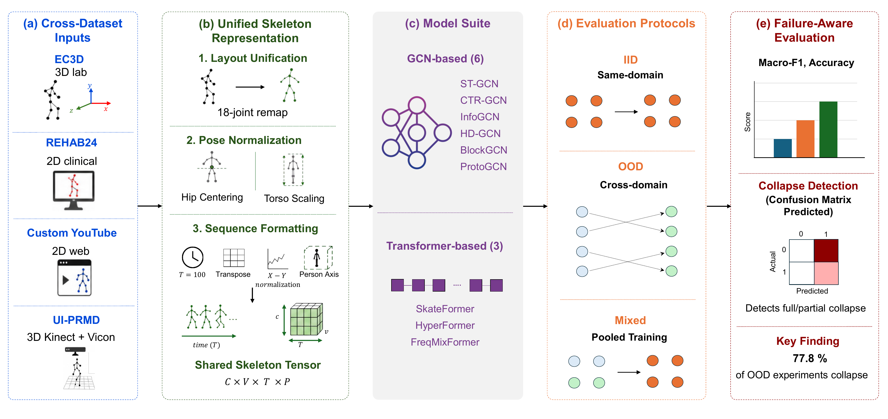

# Skeleton-Based Exercise Quality Assessment Under Domain Shift

**A Benchmark Study of Cross-Domain Failure Modes**

**Monica Vahdati**<sup>1</sup>, **Kamran Gholizadeh HamlAbadi**<sup>1</sup>, **Ali Etemad**<sup>2</sup>, **Abdulmotaleb El Saddik**<sup>1</sup>

<sup>1</sup>MCRLab, University of Ottawa &nbsp;&nbsp; <sup>2</sup>Queen's University

The 3rd International Workshop on Multimedia Computing for Health and Medicine (MCHM '26), ACM Multimedia 2026, Rio de Janeiro

[](https://dl.acm.org/doi/10.1145/3840471.3842592)
[](https://skeletoneqa.github.io/)



*Figure 1 of the paper: four datasets are unified under one preprocessing protocol and evaluated with nine skeleton models under IID, OOD and Mixed conditions. Collapse is detected from per-class prediction counts.*

We benchmark nine skeleton-based models (six GCNs and three transformers) on squat quality classification across four
datasets (EC3D, REHAB24-6, UI-PRMD and a Custom YouTube collection), under within-distribution (IID), out-of-distribution
(OOD) and pooled (Mixed) protocols. Of 198 OOD transfer experiments (9 models × 22 conditions), 154 (77.8%) end in full or
partial classifier collapse: the model assigns (almost) every sample to one class, which accuracy and macro-F1 can hide.
Collapse is detected from the per-class prediction counts of the confusion matrix. In the pooled Mixed condition no model collapses.

| Model | Collapsed OOD conditions (of 22) | Mean OOD macro-F1 [%] |
|:--|--:|--:|
| ST-GCN | 18 (81.8%) | 34.59 |
| CTR-GCN | 19 (86.4%) | 35.04 |
| InfoGCN | 16 (72.7%) | 36.02 |
| BlockGCN | **14 (63.6%)** | 35.87 |
| HD-GCN | 16 (72.7%) | **36.70** |
| ProtoGCN | 18 (81.8%) | 34.28 |
| SkateFormer | **14 (63.6%)** | 36.41 |
| HyperFormer | 19 (86.4%) | 32.59 |
| FreqMixFormer | 20 (90.9%) | 33.91 |

Collapse counts are from Table 4 and mean macro-F1 values from Table 7 of the paper. The nine means span only 4.1 points, and
after Bonferroni correction no pair of models differs significantly (one of 36 pairs is significant before correction, HD-GCN vs
HyperFormer, p = 0.046). All experiments are single runs, so the results are exploratory.

## Read this first

1. **Single-seed, exploratory results.** Every experiment was trained once with seed 42. The paper states that the resulting
   rankings and statistical tests "should be regarded as exploratory".
2. **Only part of the benchmark can be rebuilt from public data.** The Custom YouTube collection is not part of this release
   (no data, no downloader, no clip lists; `preprocessing/custom_interface.md` documents only the array format a loader would
   have to produce). 16 of the 22 OOD conditions, A3 and D1 need it and are **not reproducible** from this repository:
   B2, B4, B5, B6, B9, B12, C1–C10, A3, D1. Reproducible from the three public datasets: **A1, A2, A4** (LOSO) and
   **B1, B3, B7, B8, B10, B11** (single-source OOD).
3. **No data, derived tensors or checkpoints are included.** `results/` holds aggregate counts and metrics only.
4. **Three of the nine models are not included** (CTR-GCN, InfoGCN, FreqMixFormer; licence reasons, see [Models](#models)).
5. **Restructured and only partly tested.** The scripts were restructured for this release and tested on synthetic data only.
   No trainer or converter has been run end to end on the public datasets in this layout, and `requirements.txt` has not been
   installed from scratch in a clean Python 3.8 environment. The commands in `docs/reproduction.md` are therefore unverified.
6. **Differences between the paper and the stored code or results** are listed with evidence in
   [`docs/KNOWN_DIFFERENCES.md`](docs/KNOWN_DIFFERENCES.md).

## What this repository contains

- `preprocessing/`: the converters for EC3D, REHAB24-6 and UI-PRMD (18-joint OpenPose format, hip centring, torso scaling).
- `models/`: six of the nine model implementations, with their upstream licences.
- `training/`: the original trainer scripts used for the paper, the LOSO and OOD split builders, the collapse check and the
  UI-PRMD rerun script.
- `splits/`: a script that writes the splits as integer index lists (no data).
- `eval/`: the scripts behind the collapse, macro-F1 and Wilcoxon results.
- `results/`: the stored results of the paper (198 OOD results, IID and Mixed results, Wilcoxon tests, confusion counts, the
  UI-PRMD rerun).

Not included: datasets, derived tensors, checkpoints, the Custom YouTube material, and the three models listed above.

## Datasets (not distributed here)

Obtain each dataset from its authors; see the references in the paper. Licences are listed as far as they were checked.

| Dataset (paper reference) | Public-only conditions that use it | Licence |
|:--|:--|:--|
| EC3D, Zhao et al., ACCV 2022 | A1, B1, B3, B7, B10 | not verified |
| REHAB24-6, Černek et al., SISAP 2024 | A2, B1, B3, B8, B11 | CC BY-NC 4.0 (Zenodo record); verify at the source |
| UI-PRMD, Vakanski et al., Data 2018 | A4, B7, B8, B10, B11 | not verified |
| Custom YouTube | none | not part of this release |

Details: [`docs/data_access.md`](docs/data_access.md).

## Install

Python 3.8 (the environment the results were produced in; newer versions are untested).

```bash
conda create -n ood-bench python=3.8
conda activate ood-bench
pip install -r requirements.txt
```

## Reproduce the paper

Step-by-step commands are in [`docs/reproduction.md`](docs/reproduction.md). The map from each paper element to the script and
the stored result file is in [`docs/PAPER_TO_CODE.md`](docs/PAPER_TO_CODE.md); in short:

| Paper | Script | Stored result |
|:--|:--|:--|
| Table 4 (collapse counts) | `eval/collapse.py` | `results/collapse_stats.txt` |
| Table 5 (IID, Mixed) | trainers in `training/` | `results/iid_results/`, `results/mixed_results/` |
| Table 6 (OOD macro-F1) | trainers in `training/`, `training/check_confusion.py`, `eval/recompute_macro_f1.py` | `results/ood_results.csv`, `results/confusion_all_models.txt` |
| Table 7, Wilcoxon tests | `eval/wilcoxon.py` | `results/wilcoxon.csv` |
| Section 6.5 (UI-PRMD rerun) | `training/retrain_uiprmd_experiments.py`, `eval/rerun_status_changes.py` | `results/uiprmd_rerun/` |

Training from scratch needs the datasets. The paper's numbers come from single runs, so re-running is not expected to reproduce
individual cells exactly (see `docs/KNOWN_DIFFERENCES.md`, D7).
Trained checkpoints: [SkeletonEQA collection on Hugging Face](https://huggingface.co/collections/MonicaVahd/skeletoneqa-ood-benchmark-weights)

## Models

| Model | Upstream | Licence | In this repository |
|:--|:--|:--|:--|
| ST-GCN | https://github.com/yysijie/st-gcn | BSD 2-Clause | yes |
| HD-GCN | https://github.com/Jho-Yonsei/HD-GCN | MIT | yes |
| ProtoGCN | https://github.com/firework8/ProtoGCN | MIT | yes |
| SkateFormer | https://github.com/KAIST-VICLab/SkateFormer | MIT | yes |
| BlockGCN | https://github.com/ZhouYuxuanYX/BlockGCN | Apache-2.0 | yes, modified |
| HyperFormer | https://github.com/ZhouYuxuanYX/Hyperformer | Apache-2.0 | yes, modified |
| CTR-GCN | https://github.com/Uason-Chen/CTR-GCN | CC BY-NC 4.0 | no |
| InfoGCN | https://github.com/stnoah1/infogcn | no licence file | no |
| FreqMixFormer | https://github.com/wenhanwu95/FreqMixFormer | no licence file | no |

`scripts/fetch_upstream.py` can download the upstream files of the three excluded models at a pinned commit. It only downloads:
the paper's configuration changes are not applied and `models/builders.py` still raises an error for these three models. The
commit used for the paper is unknown; see the header of the script. Licence texts are in `THIRD_PARTY_LICENSES/` and notices in `NOTICE`.

## Repository layout

```
preprocessing/  converters (EC3D, REHAB24-6, UI-PRMD) and shared helpers
configs/        constants, EC3D subject-list loader, example subject list
models/         six model implementations and builders.py
training/       original trainers, split builders, collapse check, UI-PRMD rerun
splits/         index-list generator
eval/           collapse, macro-F1, Wilcoxon and rerun scripts
results/        stored aggregate results
scripts/        trainer launcher, fetch_upstream.py
experimental/   a single-file trainer that was NOT used for the paper
tests/          preprocessing tests on synthetic data
docs/           PAPER_TO_CODE, KNOWN_DIFFERENCES, reproduction, data access
assets/         Figure 1 of the paper
```

## Licence

Own code: Apache License 2.0 ([LICENSE](LICENSE)). Third-party model code keeps its upstream licence
([THIRD_PARTY_LICENSES/](THIRD_PARTY_LICENSES/), [NOTICE](NOTICE)); datasets keep their own licences (see above).
Figure 1 is taken from the paper, which is published under CC BY 4.0.

This code was developed with AI assistance; the author reviewed the output.

## Citation

If you use this code or the benchmark, please cite the paper (available at
[ACM DL](https://dl.acm.org/doi/10.1145/3840471.3842592); project page: <https://skeletoneqa.github.io/>):

```bibtex
@inproceedings{10.1145/3840471.3842592,
  author    = {Vahdati, Monica and Gholizadeh HamlAbadi, Kamran and Etemad, Ali and El Saddik, Abdulmotaleb},
  title     = {Skeleton-Based Exercise Quality Assessment Under Domain Shift: A Benchmark Study of Cross-Domain Failure Modes},
  year      = {2026},
  isbn      = {9798400729256},
  publisher = {Association for Computing Machinery},
  address   = {New York, NY, USA},
  url       = {https://doi.org/10.1145/3840471.3842592},
  doi       = {10.1145/3840471.3842592},
  booktitle = {Proceedings of the 3rd International Workshop on Multimedia Computing for Health and Medicine},
  pages     = {43--52},
  numpages  = {10},
  location  = {Rio de Janeiro, Brazil},
  series    = {MCHM '26}
}
```

Questions and issues: please open a GitHub issue.
